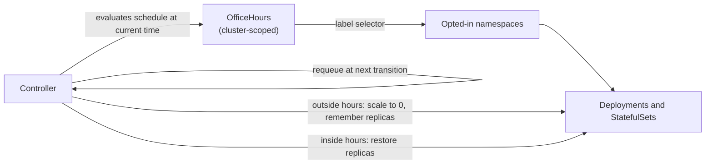

# office-hours-operator

[](https://github.com/yonigofman/office-hours-operator/actions/workflows/test.yml)
[](https://github.com/yonigofman/office-hours-operator/actions/workflows/lint.yml)
[](https://github.com/yonigofman/office-hours-operator/actions/workflows/test-e2e.yml)
[](https://goreportcard.com/report/github.com/yonigofman/office-hours-operator)
[](LICENSE)

A Kubernetes operator that puts dev and staging namespaces to sleep outside working hours and wakes them up in the morning, so idle environments stop holding CPU, memory and GPUs overnight.

<!-- Demo GIF goes here once recorded: 19:00 -> workloads scale to 0, 08:00 -> they come back. -->

## Why

Development and staging environments run around the clock but are used for about 50 hours a week. On-prem, that idle capacity is capacity other teams cannot schedule on, and on GPU nodes it is the most expensive capacity in the cluster. The usual fix is a CronJob or a script that someone wrote once and nobody owns.

office-hours-operator turns it into a declarative policy: the platform team defines working hours once, teams opt their namespaces in with a label, and the operator handles scaling down, scaling up, time zones, daylight saving time and cleanup.

## How it works



On every reconcile the controller:

1. Parses the schedule and evaluates it at the current time in the schedule's time zone: **awake** or **asleep**, and when that changes next.
2. Finds the namespaces matching `namespaceSelector`, and the Deployments and StatefulSets in them.
3. **Asleep:** scales each workload to 0 and records its replica count in an annotation. **Awake:** restores the recorded count and removes the annotations.
4. Writes `phase`, `nextTransition`, `managedWorkloads` and a `Ready` condition to status.
5. Requeues itself for the next transition, so it does no work between transitions.

The controller is level-triggered: if it was down at the moment of a transition, it reconciles every schedule against the current time when it starts and catches up.

## Quick start

Requirements: [kind](https://kind.sigs.k8s.io/), Docker, kubectl, Go 1.25+.

```bash
git clone https://github.com/yonigofman/office-hours-operator.git
cd office-hours-operator

kind create cluster --name office-hours
make docker-build IMG=office-hours-operator:dev
kind load docker-image office-hours-operator:dev --name office-hours
make deploy IMG=office-hours-operator:dev
```

Create a team namespace with a workload, and opt the namespace in:

```bash
kubectl create namespace team-a-dev
kubectl label namespace team-a-dev scheduling.yonigofman.github.io/office-hours=enabled
kubectl create deployment web -n team-a-dev --image=nginx --replicas=2
```

Apply a schedule that is open only one minute a day, so it is almost certainly closed right now:

```bash
kubectl apply -f - <<'EOF'
apiVersion: scheduling.yonigofman.github.io/v1alpha1
kind: OfficeHours
metadata:
  name: demo
spec:
  namespaceSelector:
    matchLabels:
      scheduling.yonigofman.github.io/office-hours: enabled
  timeZone: UTC
  workdays: [Sunday, Monday, Tuesday, Wednesday, Thursday, Friday, Saturday]
  start: "03:00"
  end: "03:01"
EOF

kubectl get oh
kubectl get deploy web -n team-a-dev          # READY 0/0
```

Delete the schedule and everything wakes up again:

```bash
kubectl delete oh demo
kubectl get deploy web -n team-a-dev          # READY 2/2
```

Clean up with `make undeploy` and `kind delete cluster --name office-hours`.

## Usage

### A schedule

```yaml
apiVersion: scheduling.yonigofman.github.io/v1alpha1
kind: OfficeHours
metadata:
  name: israel-dev-week
spec:
  namespaceSelector:
    matchLabels:
      scheduling.yonigofman.github.io/office-hours: enabled
  timeZone: Asia/Jerusalem
  workdays: [Sunday, Monday, Tuesday, Wednesday, Thursday]
  start: "08:00"
  end: "19:00"
```

| Field | Required | Description |
| --- | --- | --- |
| `namespaceSelector` | yes | Standard label selector for the namespaces to manage. Must not be empty: an empty selector would match every namespace. |
| `timeZone` | yes | IANA time zone, for example `Asia/Jerusalem` or `UTC`. Daylight saving time is handled. |
| `workdays` | yes | 1 to 7 of `Sunday` ... `Saturday`, no duplicates. |
| `start` | yes | When namespaces wake up, `HH:MM` 24-hour local time. |
| `end` | yes | When namespaces go to sleep, `HH:MM`. If `end` is earlier than `start`, the window crosses midnight and belongs to the day it started. |

Invalid input is rejected by the API server: wrong time format, no workdays, an unknown weekday, an empty time zone or selector, or `start` equal to `end`.

### Night shifts

A window that crosses midnight is written with `end` earlier than `start`:

```yaml
spec:
  timeZone: Asia/Jerusalem
  workdays: [Sunday, Monday, Tuesday, Wednesday, Thursday]
  start: "22:00"
  end: "06:00"      # Sunday's window runs until Monday 06:00
```

### Keeping one workload running

Annotate a Deployment or StatefulSet to exclude it, even when its namespace is selected:

```bash
kubectl annotate deployment bank-api-mock -n team-a-dev scheduling.yonigofman.github.io/exclude=true
```

### Status

```text
$ kubectl get oh
NAME              PHASE    NEXT TRANSITION        WORKLOADS   READY   AGE
israel-dev-week   Asleep   2026-10-29T06:00:00Z   7           True    3d
```

`NEXT TRANSITION` is shown in UTC. The full message, with local time, is on the `Ready` condition:

```bash
kubectl get oh israel-dev-week -o jsonpath='{.status.conditions[?(@.type=="Ready")].message}'
# Asleep until Thu 2026-10-29 08:00 IST
```

| `Ready` reason | Status | Meaning |
| --- | --- | --- |
| `ScheduleApplied` | True | Workloads match the schedule. |
| `InvalidTimeZone` | False | The time zone does not exist. Everything this schedule put to sleep is woken up. |
| `InvalidSchedule` | False | The schedule could not be parsed. Everything is woken up. |
| `OverlappingSchedules` | False | Some workloads are already managed by another `OfficeHours` and were skipped. |
| `ApplyFailed` | False | Scaling a workload failed; the controller retries with backoff. |

### Annotations

| Annotation | Set by | Purpose |
| --- | --- | --- |
| `scheduling.yonigofman.github.io/exclude` | You | `"true"` keeps the workload running outside office hours. |
| `scheduling.yonigofman.github.io/original-replicas` | Operator | Replica count to restore in the morning. |
| `scheduling.yonigofman.github.io/managed-by` | Operator | Which `OfficeHours` put the workload to sleep. |

## Behavior in edge cases

| Situation | What happens |
| --- | --- |
| Someone scales a workload up at night | The schedule wins and it goes back to 0. The morning replica count is kept. Use the exclude annotation to run something at night. |
| The operator is down at a transition | When it starts, it reconciles against the current time and catches up. |
| A workload has a HorizontalPodAutoscaler | Kubernetes does not autoscale a workload with 0 replicas, and resumes once replicas are restored. |
| Two schedules select the same namespace | The first one to put a workload to sleep owns it. The other skips it and reports `OverlappingSchedules`. |
| A namespace loses its opt-in label at night | Its workloads are woken up on the next reconcile. |
| A schedule is deleted at night | A finalizer wakes every workload it put to sleep before the object is removed. |
| The schedule becomes invalid | The operator fails open: everything it put to sleep is woken up. |
| A workload was already at 0 replicas | It is left alone and is not woken up in the morning. |

## Design decisions

- **Cluster-scoped.** A schedule reaches across namespaces, so it is a platform policy guarded by cluster-level RBAC. A namespaced version that could select other namespaces would let anyone with access to one namespace switch off workloads in another.
- **Time is injected.** The controller reads time from an injected clock, and all schedule logic lives in a pure `internal/schedule` package. Tests can run any moment, including midnight, weekends and both daylight saving changes, without waiting for them.
- **Wall-clock times, not durations.** `08:00` is computed in the schedule's time zone each day, so a 23- or 25-hour day around DST never shifts the window by an hour.
- **State lives on the workload.** The replica count to restore is an annotation on the workload itself, so the operator keeps no state of its own and survives restarts.
- **Fail open.** An invalid or deleted schedule wakes everything it manages. A typo must never leave an environment switched off.

## Development

```bash
make test        # unit tests (internal/schedule) and envtest controller tests
make lint        # golangci-lint
make run         # run the controller against your current kubeconfig
make test-e2e    # build, deploy and test on a dedicated kind cluster
```

| Path | Contents |
| --- | --- |
| `api/v1alpha1/` | The `OfficeHours` API: types, validation and print columns |
| `internal/schedule/` | Pure schedule logic: parsing and evaluating a moment in time |
| `internal/controller/` | The reconciler and its envtest suite |
| `config/` | Kustomize manifests: CRD, RBAC, manager, samples |

CI runs lint, unit and envtest tests, and end-to-end tests on kind for every push and pull request.

## Roadmap

- [ ] Release images to `ghcr.io` and attach `install.yaml` to GitHub releases
- [ ] Suspend CronJobs outside office hours
- [ ] Dry-run mode that only reports what it would do
- [ ] Prometheus metric for CPU-hours saved, with a Grafana dashboard
- [ ] Scope the informer cache for large clusters

## License

Licensed under the [Apache License 2.0](LICENSE).